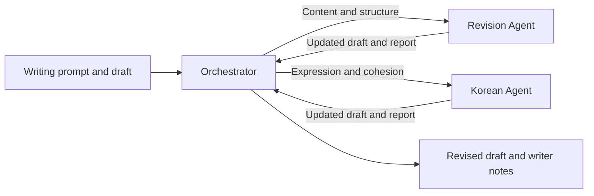

# FEAK-Agent

## Multi-Agent Revision for Korean Writing

[FEAK](https://github.com/grrlkk/FEAK) | [LIFT](https://github.com/grrlkk/LIFT) | [Corruption Data Tools](verak/v3/corrupt/)

FEAK-Agent studies how task planning, content revision, and Korean language editing can work together to revise student writing. An Orchestrator delegates revisions to two specialist agents and reviews their reports against the current draft.

## Three-Agent Writing Revision



### Objective

- Separate revision planning from content editing and Korean language correction
- Preserve the writer's meaning while addressing problems in the draft
- Keep each agent informed of changes made by the others

### Approach

- The **Orchestrator** identifies revision goals, assigns tasks, and decides when to finish
- The **Revision Agent** edits content, sentence order, and paragraph structure within the assigned scope
- The **Korean Agent** checks connective endings, conjunctions, omitted subjects, particles, register, spelling, and spacing
- Worker reports and the updated document are returned to the Orchestrator for subsequent decisions
- Questions that require the writer's knowledge or experience are retained as writer notes

The cooperation runner is implemented in [`verak/v5/cooperate.py`](verak/v5/cooperate.py). The simpler API comparison in [`verak/v5/luna_simple.py`](verak/v5/luna_simple.py) runs planning, revision, and Korean editing sequentially on a fixed set of ten training essays.

## Korean Linguistic Observations

### Objective

- Track how structural edits affect the interpretation of nearby sentences
- Provide linguistic evidence for revision without treating every detected change as an error

### Approach

- Use Bareun analysis to describe Korean markers and sentence structure
- Record changes to sentence order, neighboring sentences, connectives, and register
- Pass the current document and relevant observations between agents
- Retain action histories and unresolved tasks for later review

## Corruption Data Generation

### Objective

- Construct revision tasks with known perturbations
- Evaluate recovery separately from overall writing quality
- Retain the source, location, and operator for each change

### Approach

- Generate structural perturbations such as paragraph swaps and sentence moves
- Generate Korean language perturbations involving connective endings, conjunctions, subject insertion, register, and spacing
- Filter candidates through instance-level quality checks
- Build training and development corpora from the accepted candidates

Operator definitions are in [`operators.py`](verak/v3/corrupt/operators.py), candidate generation in [`instance_policy.py`](verak/v3/corrupt/instance_policy.py), and corpus assembly in [`final_corpus.py`](verak/v3/corrupt/final_corpus.py).

## Implementation

| Component | Location |
|:--|:--|
| Orchestrator | [`verak/v4/orchestrator_v44.py`](verak/v4/orchestrator_v44.py) |
| Revision and Korean agents | [`verak/v4/policy_prompts_v43.py`](verak/v4/policy_prompts_v43.py) |
| Editing environment | [`verak/v4/environment_v46.py`](verak/v4/environment_v46.py) |
| Agent coordination | [`verak/v5/cooperate_env.py`](verak/v5/cooperate_env.py) |
| Corruption pipeline | [`verak/v3/corrupt/`](verak/v3/corrupt/) |

The versioned modules share runtime code. Earlier Planner–Reviser–RV experiments remain in `feak_tc/agent/` and `verak/src/`; their entry points are `scripts/run_pilot.py` and `python -m verak.src.run_single --mode loop`.

## Usage

Run commands from the repository root in the configured research environment:

```bash
# Inspect the three-agent runners
python -m verak.v5.cooperate --help
python -m verak.v5.luna_simple --help

# Inspect the corruption pipeline
python -m verak.v3.cli.prepare_corruption_sources --help
python -m verak.v3.cli.build_corruption_candidates --help
python -m verak.v3.cli.finalize_corruptions --help
```

The runners use local checkpoints, fixed experiment cohorts, and Bareun services. Resource settings are defined in `verak/v3/config.yaml` and the versioned runtime modules. Student data, model weights, and experiment outputs are not distributed with this repository.

```bash
python -m pytest -q
python -m pytest -q --import-mode=importlib verak/v3/tests verak/v4/tests verak/v5/tests
```

## Related Work

- [FEAK](https://github.com/grrlkk/FEAK): feature-based assessment and evidence-based feedback for Korean writing
- [LIFT](https://github.com/grrlkk/LIFT): iterative feedback and replanning through a Coordinator and a Feedback agent

## License

[MIT](LICENSE). See [NOTICE](NOTICE) for third-party acknowledgments.
